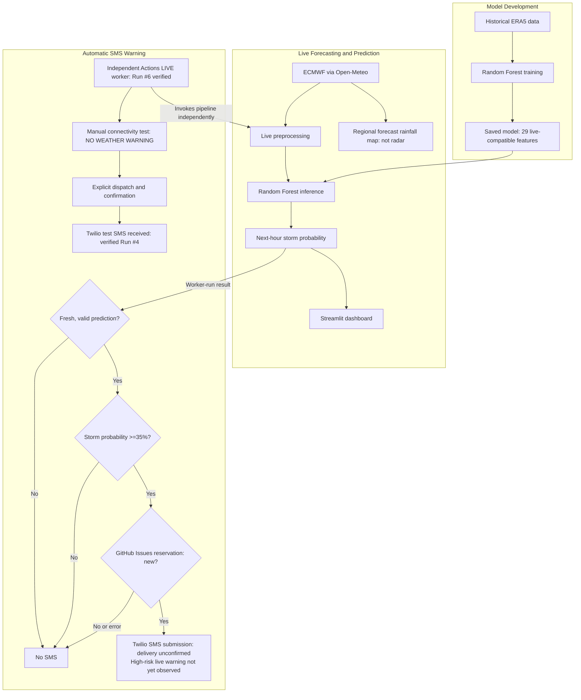

# 🌩️ Matatiele Smart Resilient Storm Early Warning System

**Research project:** *Smart Resilient Storm Early Warning System for Low Connectivity Environments: A Case of Matatiele*

**Status:** Academic Beta prototype · **Location:** Matatiele, Eastern Cape, South Africa

**[Explore the live dashboard](https://matatiele-storm-early-warning-system-jykpxurtek3zejgqfk5xvr.streamlit.app/)**


## Overview

A machine-learning research prototype designed to support earlier awareness of potential storms in Matatiele. It combines historical weather data, genuine forecasts, a Random Forest classifier trained on historical ERA5 data, interactive weather visualisations and SMS integration. The current Beta is Internet-dependent; resilient offline deployment is a future research goal.

## Key Features

- **Next-hour storm prediction:** Random Forest model using 29 live-compatible features and a **35% warning threshold**.
- **Live weather inputs:** ECMWF forecasts retrieved through Open-Meteo.
- **Interactive dashboard:** Eight Streamlit pages covering forecasts, risk, maps, history and alerts, with a weather-themed interface that follows the system's light or dark setting (respects reduced-motion preferences).
- **Rainfall map:** Satellite, street or low-data basemap; the overlay can be switched off; points show their forecast values on hover or tap.
- **Resident view:** A plain-language status card (modelled risk, forecast period, last update, coverage area) and safety advice on lightning, flooding, roads, rivers and livestock. A low-data text version is available at `?view=text`.
- **Warning simulation:** Administrators (login shown via `?admin=1`, password required) can show a clearly labelled 60% simulated warning with an SMS preview. It is on screen only: nothing is sent or saved.
- **Rainfall visualisation:** Genuine ECMWF forecast-grid samples interpolated over a satellite basemap; **not live radar**.
- **SMS integration:** Twilio connectivity tests and LIVE-enabled worker warnings when fresh predictions meet the 35% threshold.
- **Scheduled checks:** Independent GitHub Actions worker runs genuine predictions in approved LIVE mode, without requiring an open dashboard.

## System Architecture

Historical ERA5 training is separate from genuine ECMWF inference. The LIVE-enabled worker applies freshness, threshold and duplicate-submission safeguards before warning submission.



## Getting Started

**1. Clone the repository**

```powershell
git clone https://github.com/mdvar2/matatiele-storm-early-warning-system.git
cd matatiele-storm-early-warning-system
```

**2. Set up Python 3.12 and install dependencies**

```powershell
py -3.12 -m venv .venv
.\.venv\Scripts\Activate.ps1
python -m pip install -r requirements.txt
```

**3. Start the dashboard**

```powershell
python -m streamlit run 16_dashboard.py
```

Open `http://localhost:8501`. Internet access is needed to retrieve current forecasts.

**Optional: Test the scheduled forecast check without sending SMS**

```powershell
python 18_scheduled_sms_worker.py --dry-run
```

Administrator SMS features require private settings in `.streamlit/secrets.toml`, created from `.streamlit/secrets.toml.example`. **Never commit passwords, Twilio credentials or recipient numbers.** See [SMS configuration and safety](README_SMS_SETUP.md).

## Resident SMS Registration and Documentation

Residents can register their own mobile number for SMS storm warnings on the dashboard's **SMS Alerts** page. They verify ownership with a one-time code and can check or cancel the subscription at any time. Numbers are stored encrypted in a private repository. This feature is **off until configured**: registration shows *not open yet*, and subscriber warnings need `SUBSCRIBER_ALERTS_ENABLED=true`.

- [Resident User Manual](docs/RESIDENT_USER_MANUAL.md)
- [Administrator and System Maintenance Manual](docs/ADMINISTRATOR_AND_MAINTENANCE_MANUAL.md)
- [Deployment and Configuration](docs/DEPLOYMENT_AND_CONFIGURATION.md), including the Twilio trial restriction and the POPIA notes
- [End-to-end test evidence](evaluation_reports/integrated_application_evidence_2026-10-30/README.md)

## Beta Status and Limitations

**Verified:** Genuine ECMWF retrieval and Random Forest inference; unattended scheduled LIVE execution (run #6, **0.00%**, below 35%, so no warning SMS); real phone receipt of the explicitly labelled **NO WEATHER WARNING** connectivity test (run #4); **77 automated tests and 28 subtests** passed.

**Not yet observed:** Automatic storm-warning submission and delivery during a genuine high-risk event. High-risk decisions, duplicate prevention, configuration validation and uncertain outcomes have been tested with mocks. A successful LIVE run below threshold does not demonstrate warning delivery, and API acceptance is not confirmed recipient delivery.

The dashboard does not send storm warnings itself. It sends only the one-time verification codes for resident registration; warnings come from the hourly worker. Its private settings are separate from GitHub Actions secrets. See [SMS configuration and safety](README_SMS_SETUP.md) for the approved LIVE setup and safeguards.

**Future work:** Local sensors, Raspberry Pi/edge processing, offline resilience, LoRa, field validation and further assessment of forecast accuracy.

> **Research disclaimer:** This is an academic Beta prototype, not an official South African Weather Service (SAWS) warning service. Follow official weather alerts and local disaster-management guidance.
