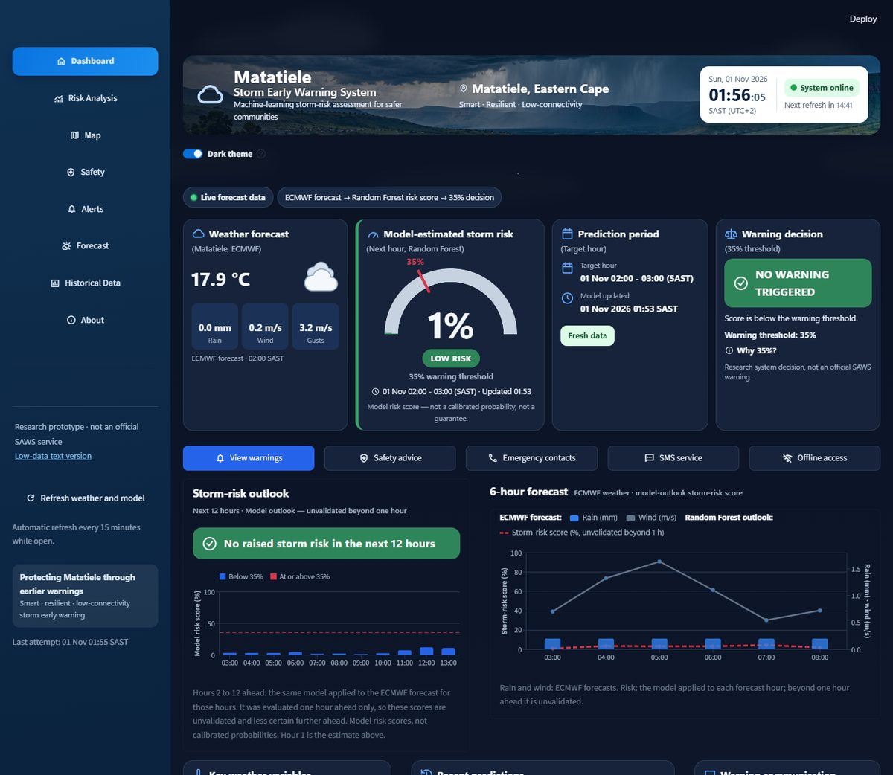
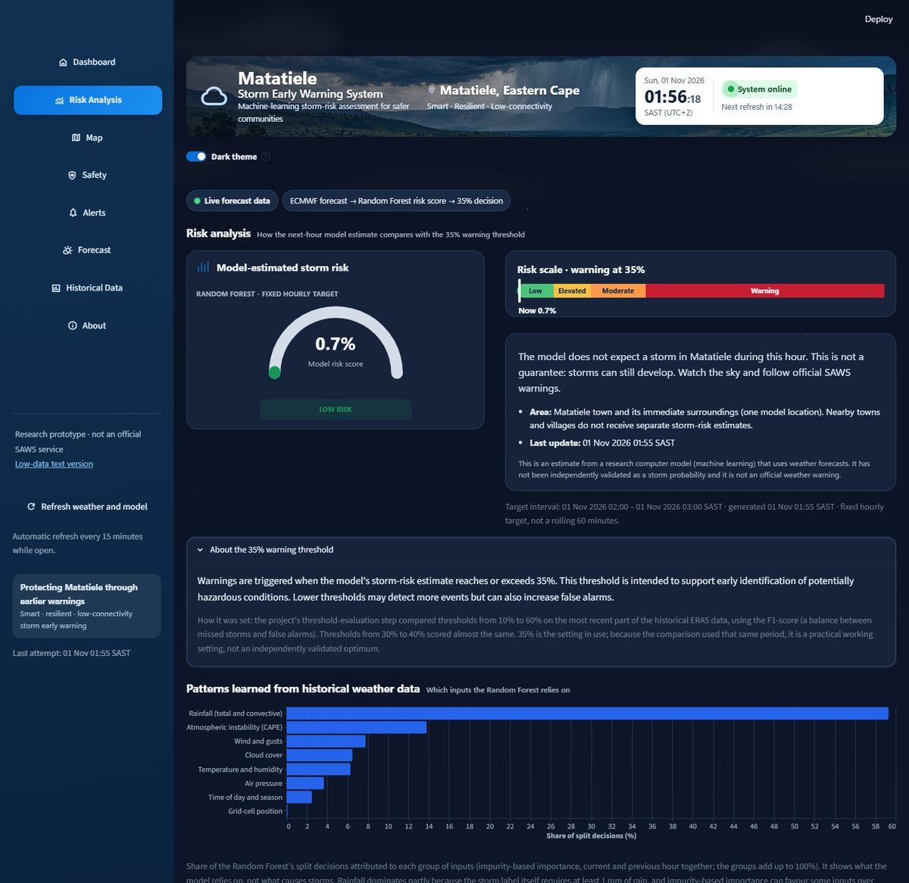
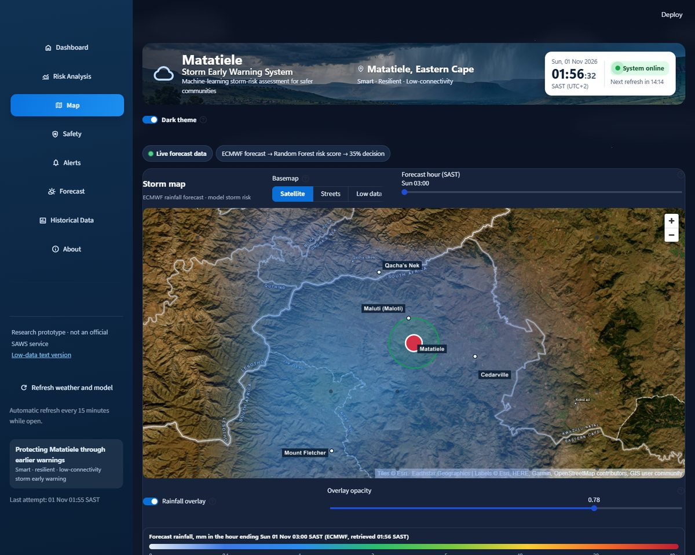
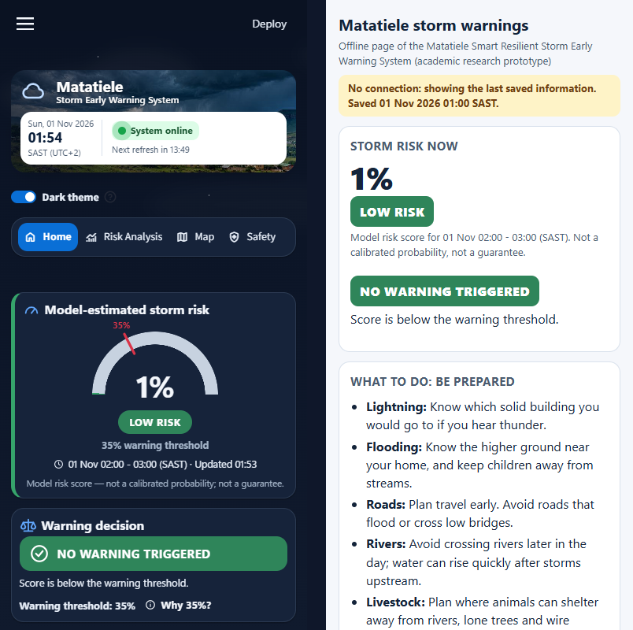

# Matatiele Smart Resilient Storm Early Warning System

**Research title:** *Smart Resilient Storm Early Warning System for Low-Connectivity Environments: A Case of Matatiele*

**Research Objective 3 (RO3):** To design and develop a smart resilient storm early warning system for low-connectivity environments, using Matatiele as a case study.

**Status:** academic research prototype · **Location:** Matatiele, Eastern Cape, South Africa · **[Live dashboard](https://matatiele-storm-early-warning-system-jykpxurtek3zejgqfk5xvr.streamlit.app/)**


> **Disclaimer:** academic research prototype, not an official weather warning service. Follow official warnings (South African Weather Service) and local emergency guidance.



## System purpose

```
ECMWF forecast inputs → Random Forest storm-risk assessment → 35% warning decision → resident warning information → resilient low-connectivity communication support
```

| Step | What it is |
|---|---|
| **External forecasts** | ECMWF IFS forecasts retrieved hourly through Open-Meteo. The system **does not produce weather forecasts**. |
| **Random Forest risk assessment** | The trained model turns the forecast variables into a **next-hour model risk score** for Matatiele |
| **Warning decision** | A warning is decided when the score reaches the **35% warning-decision threshold**, and the warning is recorded publicly |
| **Resilient communication** | Dashboard warnings, a low-data view, an offline saved-information page, SMS (simulation; public delivery disabled) and community-relay support |

A model risk score is **not a calibrated probability**, and 35% is a warning-decision threshold, not a confidence level or an accuracy figure.

## Model-development workflow (historical, done once)

```
ERA5 reanalysis (2018 onwards) → preprocessing (scripts 01–04, 06) → storm labels and features (03, 05, 06)
  → Random Forest training (14) → evaluation and threshold comparison (15, 25) → saved model (outputs/model_live/)
```

## Operational workflow (every hour)

```
ECMWF via Open-Meteo → feature preparation (29 inputs) → Random Forest → next-hour model risk score
  → 35% threshold → warning record (public GitHub ledger) → Alerts page, dashboard, optional SMS
```

The hourly worker (`18_scheduled_sms_worker.py`, GitHub Actions) decides warnings, so the dashboard does not have to be open. Each run's sanitised record is published to a monthly public `[RUN-LOG] YYYY-MM` issue, which is the durable prediction log.

## Model

- **Classifier:** `RandomForestClassifier` with 300 trees, balanced class weights and `random_state=42` (`14_train_live_compatible_random_forest.py`).
- **Inputs (29):** the current and previous hour of temperature, dew point, sea-level and surface pressure, precipitation, CAPE, convective precipitation, cloud cover, wind components, gusts and wind speed, plus latitude, longitude, hour, month and day of year.
- **Target:** the **next hour's** ERA5-derived proxy storm label (`03_create_labels.py`): at least 1 mm of rain **and** CAPE ≥ 200 J/kg, convective rain ≥ 0.5 mm, K-index ≥ 26 or cloud cover ≥ 90%. These are not observed storm reports.
- **Chronological evaluation:** the most recent 20% (30,455 cell-hours, 860 labelled storm hours) was held out. A stricter evaluation with a separate validation year is in `evaluation_reports/ml_evaluation_2026-10-29/`.
- **Persistence comparison:** "the next hour will be like this hour".
- **Calibration:** not calibrated. Scores run higher than the labelled storm frequency, so a score is a relative risk level.

### The 35% threshold (held-out period, warning when the score is at or above 35%)

| Measure | Value |
|---|---|
| Precision | ≈ 51.6% |
| Recall | ≈ 72.0% |
| F1 | ≈ 0.601 |
| False alarms | 581 |
| Missed storm hours | 241 |
| Persistence baseline F1 | ≈ 0.559 |

- 35% is a **practical operational setting, not a proven optimum**. It was chosen by comparing F1 on the same held-out period, so these figures are optimistic, and thresholds from 30% to 40% score almost the same.
- With the threshold chosen on a separate validation year, F1 is 0.57–0.59 against 0.56 for persistence, which is **not a meaningful improvement**.
- All figures are against proxy ERA5 labels, not independently observed storms.

Details: [docs/MODEL_EVALUATION.md](docs/MODEL_EVALUATION.md).

## Current features



| Section | Content |
|---|---|
| **Dashboard** | Header with the live clock, system status and refresh countdown. Row 1: weather forecast · **model-estimated storm risk** (gauge, 35% marker) · prediction period · **warning decision** (NO WARNING TRIGGERED, THRESHOLD REACHED, WARNING TRIGGERED only with a genuine record, NO DECISION). Then actions (View warnings, Safety advice, Emergency contacts, SMS service, Offline access), the 12-hour outlook beside the 6-hour chart, key weather variables, recent predictions and the communication status. |
| **Risk Analysis** | The examiner page: current score and 35% threshold, patterns learned (feature importance), why a Random Forest, precision, recall and F1, the persistence comparison, threshold trade-offs, calibration and confidence |
| **Map** | ECMWF forecast rainfall at 25 grid cells around Matatiele, and the one-location model risk estimate. No spatial risk zones are fabricated. |
| **Safety** | Compact "Be prepared" tiles, full "Act now" advice, and tap-to-call emergency numbers (10111, 10177, 112) |
| **Alerts** | Current and past next-hour warnings, early alerts (outlook), SMS (simulation and controlled test; public disabled), and the system log |
| **Forecast** | The 36-hour ECMWF chart and the variables the model uses; states that the system does not produce forecasts |
| **Historical Data** | Saved model risk scores over 24 hours, 7 days or all, with the 35% line; gaps are left as gaps; collapsible table |
| **About** | The workflow and the RO3 status, grouped as implemented, exploratory and future |



### 12-hour storm-risk outlook (exploratory)

The same unchanged model is applied to each forecast hour, 2 to 12 hours ahead, using exactly the live script's inputs (tested).

- It is **exploratory and unvalidated beyond one hour**, because the model was evaluated for the next hour only.
- Scores are not calibrated probabilities.
- An EARLY ALERT is shown when an hour reaches 35%. Early-alert records and SMS stay off unless enabled.

## Low connectivity and resilience

| Feature | What it does |
|---|---|
| **Data freshness** | "System online" with a live pulse only while the latest retrieved forecast and model result are current. Otherwise it shows "Saved data · last update …" and no pulse, and no warning decision is made from out-of-date data. |
| **Low-data view** (`?view=text`) | Plain text: score, decision, freshness, safety advice and emergency numbers. It loads no images. |
| **Offline access** (`/app/static/offline.html`) | Opened once while connected, it keeps the last warning information, safety advice and emergency numbers, and reopens with no connection ("No connection: showing the last saved information"). It **cannot receive new warnings while offline**. |
| **Warning records** | Reserved in the public ledger before any SMS, so an SMS failure never removes a warning |
| **SMS** | Simulation implemented; see below |
| **Community relays** | See below |



### SMS

| Mode | Status |
|---|---|
| Simulation (`SMS_DELIVERY_MODE=outbox`) | Implemented: messages are labelled TEST ONLY and written to a local outbox, never sent. Reproducible with `python 26_sms_simulation_demo.py`. |
| Controlled test (`twilio`, trial account) | Only when deliberately configured: verified numbers only |
| Public subscriber delivery | **Disabled by default.** It needs a non-trial provider, POPIA compliance, ethics clearance and the project owner's authorisation. |

Duplicate prevention: one ledger record per warning hour and one delivery record per warning and subscriber, both reserved before sending. A message accepted by the provider is not proof of delivery.

### Community relays

These are **implemented in software, not field validated**:
- residents can register as relays (ward councillors, community leaders, volunteers);
- relays receive warnings with "please warn people near you (in person, loudhailer, bell)";
- each warning has an announcement script for loudhailers and community radio.

## User interface

- Responsive (desktop, tablet, phone), with light and dark themes, outline icons and keyboard-accessible controls.
- On desktop the sidebar is open: Dashboard, Risk Analysis, Map, Safety, Alerts, Forecast, Historical Data, About. On phones it sits behind ☰ and the top bar is shown.
- **Live state:** the clock and refresh countdown tick on the device, with no server reruns. "Updated just now", or "Connection restored · data updated", appears only when a genuinely newer result arrives. The gauge sweeps only when the genuine score changes.
- **Reduced motion:** with `prefers-reduced-motion`, all animation stops and the text status is unchanged.

### Visual artwork

The header uses the project's **illustrative Matatiele storm landscape artwork** (source: `Stormy Valley Overlook.png`, resized and compressed for low-data use as `static/matatiele_storm_banner*.jpg`). **It is illustrative artwork, not current weather or model evidence.** The low-data view does not load it.

## Installation

```powershell
git clone https://github.com/mdvar2/matatiele-storm-early-warning-system.git
cd matatiele-storm-early-warning-system
py -3.12 -m venv .venv
.\.venv\Scripts\Activate.ps1
python -m pip install -r requirements.txt
python -m streamlit run 16_dashboard.py
```

Open `http://localhost:8501`. Internet access is needed to retrieve forecasts.

## Configuration (names only; never commit values)

| Setting | Purpose |
|---|---|
| `SMS_DELIVERY_MODE` | `disabled` (default), `outbox` (simulation), `twilio` (controlled test) |
| `SUBSCRIBER_ALERTS_ENABLED` | `true` lets the worker message subscribers (repository variable; default off) |
| `OUTLOOK_ALERTS_ENABLED` | `true` creates early-alert records from the outlook (repository variable; default off) |
| `SUBSCRIBER_STORE`, `SUBSCRIBER_STORE_REPO`, `SUBSCRIBER_STORE_TOKEN`, `SUBSCRIBER_ENCRYPTION_KEY`, `SUBSCRIBER_HASH_KEY` | Encrypted subscriber store |
| `TWILIO_ACCOUNT_SID`, `TWILIO_AUTH_TOKEN`, `TWILIO_FROM_NUMBER`, `ALERT_TO_NUMBERS` | SMS provider (secrets) |
| `ADMIN_PASSWORD`, `OFFICIAL_ACCOUNTS` | Administrator page and officials' portal |
| `RUN_RECORD_PUBLISH` | Publishes worker run records to `[RUN-LOG]` (set in the workflow) |
| `SYSTEM_LOG_PATH` | SQLite system log (default `outputs/system_log.sqlite`) |

Private settings go in `.streamlit/secrets.toml` (template: `.streamlit/secrets.toml.example`). For a local demonstration with nothing sent, set `SMS_DELIVERY_MODE=outbox`. Setup details: [docs/DEPLOYMENT_AND_CONFIGURATION.md](docs/DEPLOYMENT_AND_CONFIGURATION.md).

## Testing

- **Command:** `python -m pytest tests/`.
- **Final run:** **393 passed, 0 failed, 0 skipped** (287 subtests). It was repeated with a process-wide network guard, which logged 0 outbound connection attempts.
- **No live SMS:** tests never send SMS or contact external services.
- **Worker equivalence:** with subscriber alerts off, the hourly worker behaves identically to the approved version (21/21 scenarios).
- **Model integrity:** the model, feature list and threshold match the approved files, and the held-out probabilities are reproduced exactly.
- **Real-browser checks:** live pulse, countdown, clock, stale state, reduced motion, phone first screen and the offline page. See `evaluation_reports/final_master_evidence_2026-11-01/`.

## Reproducibility

- **Model evidence:** `python 25_build_model_evidence.py --check` rebuilds the Risk Analysis figures from committed inputs and confirms them. See [docs/MODEL_EVALUATION.md](docs/MODEL_EVALUATION.md).
- **RO3 evidence:** [docs/RO3_EVIDENCE.md](docs/RO3_EVIDENCE.md).
- **System design:** [docs/SYSTEM_DESIGN.md](docs/SYSTEM_DESIGN.md).
- **SMS and low connectivity:** [docs/SMS_AND_LOW_CONNECTIVITY.md](docs/SMS_AND_LOW_CONNECTIVITY.md).
- **Resilient dissemination:** [docs/RESILIENT_DISSEMINATION.md](docs/RESILIENT_DISSEMINATION.md).
- **Evaluation scripts:** `15_evaluate_live_threshold.py`, `25_build_model_evidence.py`, `evaluation_reports/ml_evaluation_2026-10-29/ro3_chronological_evaluation.py`.
- **Evidence folders:** `evaluation_reports/*_evidence_*`.

## RO3 evidence

| RO3 element | Implementation | Limitation / status |
|---|---|---|
| Smart | Random Forest trained on ERA5 (29 inputs) | Validated against proxy labels only |
| Storm risk | Next-hour model risk score | Not a calibrated probability |
| Early warning | 35% decision and warning record; exploratory 12-hour outlook | Outlook unvalidated beyond 1 h |
| Resilient | Stale-data handling, offline saved information, warning records independent of SMS | No new alerts while fully offline |
| Low connectivity | Low-data view, offline page, SMS simulation, relay support | Public SMS disabled; relays not field validated |
| Matatiele case study | Matatiele model location, map and interface | One model location |

## Limitations

- Proxy ERA5 storm labels; no independent validation against observed storms.
- Scores are not calibrated probabilities.
- The validated target is the next hour; the 2–12 hour outlook is unvalidated.
- There is one model location: Matatiele town and its immediate surroundings.
- The backend needs Internet access to retrieve forecasts.
- The offline page shows the last saved information and cannot receive new alerts.
- Public SMS is disabled, and community relays have not been field validated.
- There are no deployed sensors, no physical LoRa links, no Cell Broadcast and no sirens.

## Future work

Public SMS deployment after POPIA and ethics clearance, field validation with residents and relays, evaluation against observed storm reports, probability calibration, a validated multi-hour target, physical sensors, LoRa or solar sirens, and Cell Broadcast through the authorities.

## Documentation

- [Resident user manual](docs/RESIDENT_USER_MANUAL.md)
- [Administrator and maintenance manual](docs/ADMINISTRATOR_AND_MAINTENANCE_MANUAL.md)
- [Deployment and configuration](docs/DEPLOYMENT_AND_CONFIGURATION.md)
- [System design](docs/SYSTEM_DESIGN.md)
- [Model evaluation](docs/MODEL_EVALUATION.md)
- [SMS and low connectivity](docs/SMS_AND_LOW_CONNECTIVITY.md)
- [Resilient dissemination](docs/RESILIENT_DISSEMINATION.md)
- [RO3 evidence](docs/RO3_EVIDENCE.md)
- [Storm early warning design notes](docs/STORM_EWS_DESIGN_RESEARCH.md)
