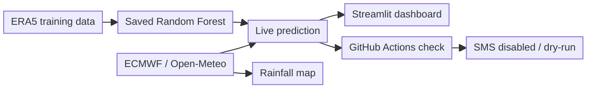

# 🌩️ Matatiele Smart Resilient Storm Early Warning System

**Research project:** *Smart Resilient Storm Early Warning System for Low Connectivity Environments: A Case of Matatiele*

**Status:** Academic Beta prototype · **Location:** Matatiele, Eastern Cape, South Africa

**[Explore the live dashboard](https://matatiele-storm-early-warning-system-jykpxrtek3zejgqfk5xvr.streamlit.app)**


## Overview

A machine-learning research prototype designed to support earlier awareness of potential storms in Matatiele. It combines historical weather data, genuine forecasts, a Random Forest classifier, interactive weather visualisations and SMS integration. The current Beta is Internet-dependent; resilient offline deployment is a future research goal.

## Key Features

- **Next-hour storm prediction:** Random Forest model using 29 live-compatible features and a **35% warning threshold**.
- **Live weather inputs:** ECMWF forecasts retrieved through Open-Meteo.
- **Interactive dashboard:** Seven Streamlit pages covering forecasts, risk, maps, history and alerts.
- **Rainfall visualisation:** Satellite-based map with interpolated regional forecast rainfall; **not live radar**.
- **SMS integration:** Administrator-controlled Twilio test messages; real automatic storm-warning SMS remains disabled.
- **Scheduled checks:** Independent GitHub Actions worker runs genuine predictions in safe dry-run mode.

## System Architecture

A simplified overview of the current Beta. Historical ERA5 data was used to train the model; live predictions use ECMWF forecasts. SMS warning delivery remains disabled.



## Getting Started

**1. Clone the repository**

```powershell
git clone https://github.com/mdvar2/matatiele-storm-early-warning-system.git
cd matatiele-storm-early-warning-system
```

**2. Set up Python 3.12 and install dependencies**

```powershell
py -3.12 -m venv .venv
.\.venv\Scripts\Activate.ps1
python -m pip install -r requirements.txt
```

**3. Start the dashboard**

```powershell
python -m streamlit run 16_dashboard.py
```

Open `http://localhost:8501`. Internet access is needed to retrieve current forecasts.

**Optional: Test the scheduled forecast check without sending SMS**

```powershell
python 18_scheduled_sms_worker.py --dry-run
```

Administrator SMS features require private settings in `.streamlit/secrets.toml`, created from `.streamlit/secrets.toml.example`. **Never commit passwords, Twilio credentials or recipient numbers.** See [SMS configuration and safety](README_SMS_SETUP.md).

## Beta Status and Limitations

**Verified:** Genuine forecast/model inference, a manually received Twilio test SMS, 73 automated safety tests and successful GitHub Actions dry-runs.

**Not yet verified:** Real unattended storm-warning delivery. Automatic SMS remains **disabled**; the dashboard cannot send storm warnings, and the independent worker is the designated future automatic sender.

**Future work:** Local sensors, Raspberry Pi/edge deployment, offline resilience, field validation and further assessment of forecast accuracy.

> **Research disclaimer:** This is an academic Beta prototype, not an official South African Weather Service (SAWS) warning service. Follow official weather alerts and local disaster-management guidance.
