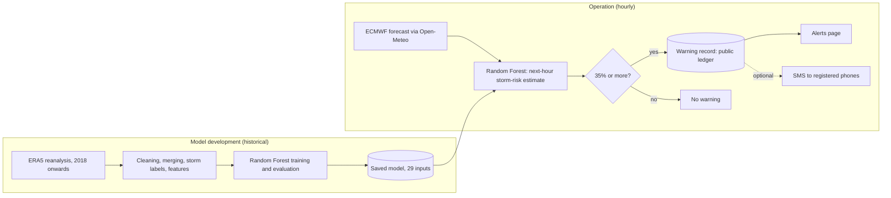

# Matatiele Smart Resilient Storm Early Warning System

**Research title:** *Smart Resilient Storm Early Warning System for Low Connectivity Environments: A Case of Matatiele*

**Research Objective 3 (RO3):** To design and develop a smart resilient storm early warning system for low-connectivity environments, using Matatiele as a case study.

**Status:** academic Beta prototype · **Location:** Matatiele, Eastern Cape, South Africa · **[Live dashboard](https://matatiele-storm-early-warning-system-jykpxurtek3zejgqfk5xvr.streamlit.app/)**


> **Disclaimer:** this is a research prototype, not an official South African Weather Service (SAWS) warning service. Follow SAWS warnings and local disaster-management guidance.

## Overview

The system **does not produce weather forecasts**. It works in three distinct steps:

| Step | What it is | Source |
|---|---|---|
| **Weather forecast** | Externally produced forecast of temperature, rainfall, wind, cloud, pressure, CAPE and related variables | ECMWF IFS (0.25°) via the Open-Meteo API, retrieved hourly |
| **Model-estimated storm risk** | The probability that the next hour is a storm hour at Matatiele, estimated from those forecast variables | Random Forest classifier trained on historical ERA5 data |
| **Warning decision** | A warning is issued when the estimate reaches or exceeds the **35% warning threshold** | Hourly worker (GitHub Actions) |

Warnings are then communicated on the dashboard's Alerts page and, when enabled and configured, by SMS.

## Architecture



Detailed stakeholder, use case, architecture and activity diagrams are in [docs/SYSTEM_DESIGN.md](docs/SYSTEM_DESIGN.md).

## The model (verified from the project scripts and evaluation reports)

- **Training data:** hourly ERA5 reanalysis for the grid cells covering Matatiele, from January 2018 (scripts `01`–`06`). Historical data supports model development only.
- **Storm label:** an hour is a storm hour when ERA5 shows at least 1 mm of total precipitation **and** at least one supporting sign: CAPE ≥ 200 J/kg, convective precipitation ≥ 0.5 mm, K-index ≥ 26, or total cloud cover ≥ 90% (`03_create_labels.py`). The model estimates the *next* hour's label (`06_prepare_model_data.py`).
- **Inputs (29):** the current and previous hour of temperature, dew point, sea-level and surface pressure, precipitation, CAPE, convective precipitation, cloud cover, wind components, gusts and wind speed, plus latitude, longitude, hour, month and day of year. The K-index is excluded, because the live forecast feed does not provide it.
- **Classifier:** `RandomForestClassifier` with 300 trees, balanced class weights and `random_state=42`, trained on the earliest 80% of the chronological record, to 25 August 2025 (`14_train_live_compatible_random_forest.py`).
- **Evaluation:** the most recent 20% was held out. See [the ML evaluation design](evaluation_reports/RO3_ml_evaluation_design_2026-10-29.md) for the documented method and its limitations.
- **Warning threshold (35%):** `15_evaluate_live_threshold.py` compared thresholds from 10% to 60% on the held-out period using the F1-score. Thresholds from 30% to 40% scored almost the same (F1 0.599–0.601), and 35% is the setting in use (`outputs/model_live/live_selected_threshold.txt`). It was compared on the same period it is reported on, so it is a **practical working setting, not an independently validated optimum**. Lower thresholds detect more events but raise more false alarms.

## Dashboard

| Section | Content |
|---|---|
| **Home** | Model-estimated storm risk (category, estimate, prediction period, model update time, the 35% threshold with a "Why 35%?" note), the weather forecast for the next hour and the next six hours, recommended actions, SMS registration, warnings, the SAWS link, tap-to-call emergency numbers and the low-data view. |
| **Forecast** | 36-hour ECMWF temperature and rainfall chart, and the forecast variables the model uses (CAPE, dew point, showers). |
| **Map** | ECMWF rainfall forecast from a 5 × 5 grid of real forecast points (about 30 km apart), interpolated and smoothed between points. It is not radar. A forecast-hour slider covers the next 35 hours, a ring shows the model-estimated storm risk at Matatiele, and there are Satellite, Streets and Low data basemaps. |
| **Safety** | Advice for before a storm and when a storm is close. |
| **☰ Alerts** | Current and past warnings, warning details, an anonymous "I have read this warning" acknowledgement, and SMS registration and management. |
| **☰ Risk Analysis** | Gauge, risk scale and the threshold explanation. |
| **☰ Historical Data** | Saved model predictions as a chart and a table. |
| **☰ About** | The resident warning workflow, how the model and system work, and the low-connectivity design. |

The dashboard has light and dark themes (a header switch, kept across pages and refreshes), uses outline icons, works at desktop, tablet and phone widths, and respects the reduced-motion setting.

## Low-connectivity design (RO3)

| Implemented | Purpose |
|---|---|
| **Low-data view** (`?view=text`) | Essential storm-risk information and safety advice as plain text, without maps, charts or images. |
| **SMS warnings** (optional) | Can reach a basic phone without the dashboard being opened; an SMS needs only mobile signal. |
| **Low data basemap** | The map without downloaded tiles. |
| **Scheduled worker** | Warnings are decided hourly on GitHub Actions; no one needs to keep the dashboard open. |

**Not implemented (future research):** offline operation, local weather sensors, edge processing and LoRa links. The system needs an Internet connection to retrieve forecasts.

## SMS and its limitations

- **Hourly worker:** `18_scheduled_sms_worker.py` (GitHub Actions) decides warnings, reserves each warning hour in a public GitHub issue ledger to prevent duplicates, and submits SMS through Twilio.
- **Resident registration** (Alerts → SMS alerts): South African mobile numbers, explicit consent, a one-time verification code, encrypted storage in a private repository, and unsubscribe at any time. **Off until configured**: registration shows *not open yet*, and subscriber warnings also need `SUBSCRIBER_ALERTS_ENABLED=true`.
- **Limitations:**
  - The Twilio account is a **trial**, which can only message verified numbers.
  - Provider acceptance is not proof of delivery.
  - An automatic warning during a genuine high-risk event has not yet been observed.

Setup: [docs/DEPLOYMENT_AND_CONFIGURATION.md](docs/DEPLOYMENT_AND_CONFIGURATION.md) and [README_SMS_SETUP.md](README_SMS_SETUP.md).

## Officials' portal

Authorised disaster-management officials sign in at `?portal=officials` with individual hashed accounts (`OFFICIAL_ACCOUNTS`, created with `23_create_official_account.py`). They can:
- review active warnings and anonymous acknowledgement counts;
- view the forecast geography;
- record a review status and notes, with their name and the time;
- export the action history.

It records decisions only; it never dispatches emergency services. Administrators have a separate password-protected page for system health and SMS delivery.

## Installation and running

```powershell
git clone https://github.com/mdvar2/matatiele-storm-early-warning-system.git
cd matatiele-storm-early-warning-system
py -3.12 -m venv .venv
.\.venv\Scripts\Activate.ps1
python -m pip install -r requirements.txt
python -m streamlit run 16_dashboard.py
```

Open `http://localhost:8501`. Internet access is needed to retrieve forecasts.

- `python 18_scheduled_sms_worker.py --dry-run` runs the hourly check without sending SMS.
- Private settings go in `.streamlit/secrets.toml` (template: `.streamlit/secrets.toml.example`). Never commit passwords, tokens, keys or phone numbers.
- For a local demonstration with nothing sent, set `SMS_DELIVERY_MODE=outbox`. `24_create_dev_test_warning.py` creates a warning labelled as a development test.

## Testing evidence

- **Automated tests:** `python -m pytest tests/`. All 344 tests (and 274 subtests) pass with network access blocked; no SMS is sent and no external service is called.
- **Worker equivalence:** with subscriber alerts off, the hourly worker behaves identically to the approved version (21/21 scenarios).
- **Model unchanged:** re-scoring the 30,455 held-out rows reproduces the saved probabilities. See [the final UI evidence](evaluation_reports/final_ui_refinement_evidence_2026-10-31/README.md).
- **Earlier verified operation:** genuine ECMWF retrieval and inference; an unattended scheduled live run (run #6, 0.00%, below 35%, so no SMS); a labelled NO WEATHER WARNING connectivity SMS received on a phone (run #4).
- **Browser walkthroughs and screenshots:** the `evaluation_reports/*_evidence_*` folders.

## Known limitations

- The storm-risk estimate covers **one location** (Matatiele town and its immediate surroundings). It has not been independently validated as a calibrated probability.
- The 35% threshold is a working setting, not a validated optimum (see above).
- Storm labels are derived from ERA5 rules, not from observed storm reports.
- Rainfall on the map is an interpolated forecast between grid points, not observed rain.
- Real SMS delivery to the public needs an upgraded Twilio account, POPIA and ethics clearance, and a private subscriber store.

## Documentation

- [Resident user manual](docs/RESIDENT_USER_MANUAL.md)
- [Administrator and maintenance manual](docs/ADMINISTRATOR_AND_MAINTENANCE_MANUAL.md)
- [Deployment and configuration](docs/DEPLOYMENT_AND_CONFIGURATION.md)
- [System design](docs/SYSTEM_DESIGN.md)
- [Storm early warning design notes](docs/STORM_EWS_DESIGN_RESEARCH.md)
