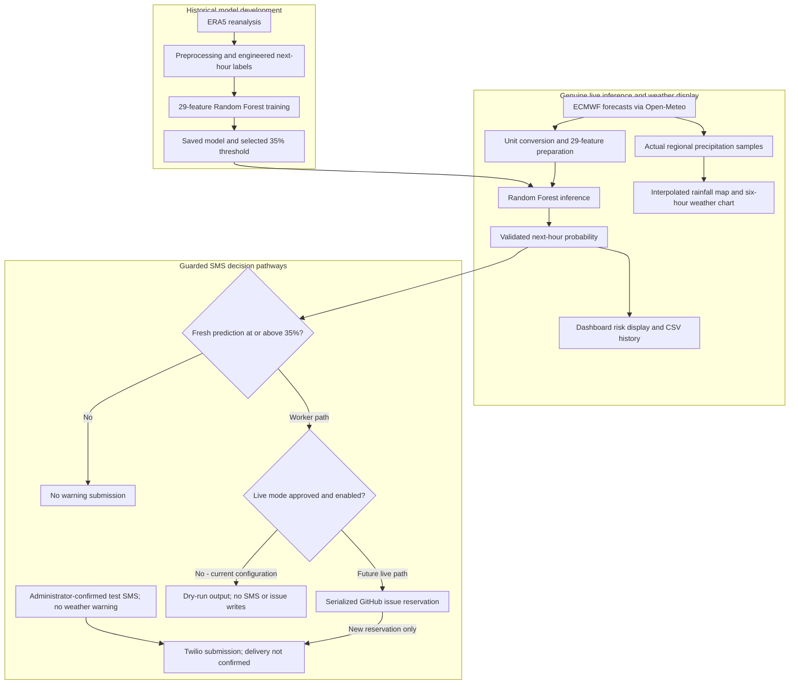

# ??? Matatiele Smart Resilient Storm Early Warning System

**Academic research title:** Smart Resilient Storm Early Warning System for Low Connectivity Environments: A Case of Matatiele

**Status: Beta prototype** | Matatiele, Eastern Cape, South Africa

**Deployed dashboard:** [https://matatiele-storm-early-warning-system-jykpxrtek3zejgqfk5xvr.streamlit.app](https://matatiele-storm-early-warning-system-jykpxrtek3zejgqfk5xvr.streamlit.app)

## Project Overview

This academic research Beta investigates how machine learning and SMS communication
can improve storm awareness for communities around Matatiele with limited access
to timely weather information. It combines an ERA5-trained Random Forest with
genuine ECMWF forecasts, an interactive dashboard and guarded SMS integration;
the current prototype requires Internet connectivity.

## Key Features

- Genuine next-hour Random Forest predictions using 29 live-compatible features
  and the selected **35% storm-warning threshold**.
- Actual ECMWF forecast data retrieved through Open-Meteo.
- Seven-page Streamlit dashboard with weather conditions, risk analysis and history.
- Interactive satellite rainfall maps using genuine forecast samples, with
  interpolation for visualisation; these are forecasts, not live radar.
- Twilio SMS integration with administrator-controlled connectivity tests.
- Independent scheduled monitoring through GitHub Actions, currently in safe dry-run
  mode; real storm-warning submission is reserved for that worker.

## System Architecture

Historical training is separate from live inference. Regional rainfall forecasts
and Random Forest storm probabilities are distinct outputs.



## Getting Started

1. **Clone the repository** and open it in Windows PowerShell:

   ```powershell
   git clone https://github.com/mdvar2/matatiele-storm-early-warning-system.git
   cd matatiele-storm-early-warning-system
   ```

2. **Use Python 3.12**, create a virtual environment and install dependencies:

   ```powershell
   python --version
   python -m venv .venv
   .\.venv\Scripts\Activate.ps1
   python -m pip install -r requirements.txt
   ```

3. **Configure private local settings** if using administrator or test SMS controls:

   ```powershell
   Copy-Item .streamlit/secrets.toml.example .streamlit/secrets.toml
   ```

   Edit the copied file privately with your administrator password and Twilio settings.
   The private file is Git-ignored; never commit credentials or recipient numbers.
   GitHub Actions uses encrypted repository secrets, independently of this local file.
   See [SMS setup and safety guidance](README_SMS_SETUP.md) for details.

4. **Launch the dashboard** and open `http://localhost:8501`:

   ```powershell
   python -m streamlit run 16_dashboard.py
   ```

5. **Optionally check genuine forecasts safely** without sending SMS:

   ```powershell
   python 18_scheduled_sms_worker.py --dry-run
   ```

   The worker runs independently of the dashboard. Dry-run sends no SMS and writes
   no GitHub warning reservations; leave real sending disabled.

## Current Status and Limitations

Manual Twilio test SMS delivery has been demonstrated. Automatic decision safeguards
have passed **73 automated tests**, and GitHub scheduled dry-runs have succeeded.
These checks verify software behaviour, not forecast accuracy or unattended delivery.

**Real unattended storm-warning SMS delivery is not yet verified and remains disabled.**
The dashboard retains manual test SMS only; the scheduled worker is the sole
storm-warning sender. Provider submission is not confirmed recipient delivery.

Autonomous offline/edge operation, Raspberry Pi deployment, local sensors and
field validation in Matatiele remain future work. This is an academic research
prototype, not an official SAWS warning service. For operational safeguards and
configuration, see [README_SMS_SETUP.md](README_SMS_SETUP.md).
