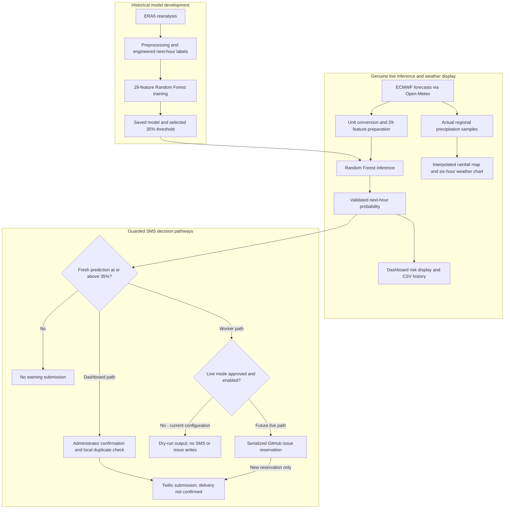

# 🌩️ Matatiele Smart Resilient Storm Early Warning System

**Academic research title:** Smart Resilient Storm Early Warning System for Low Connectivity Environments: A Case of Matatiele

**Status: Beta prototype** | Matatiele, Eastern Cape, South Africa


## Project overview

Rural communities around Matatiele can face limited access to timely weather
information and warnings. This research investigates how machine learning and
resilient communication could support next-hour storm awareness in such settings.

The current Beta combines an ERA5-trained Random Forest, genuine ECMWF forecasts
from Open-Meteo, an interactive Streamlit dashboard and guarded Twilio integration.
An independent GitHub Actions worker performs **dry-run checks only**. It retrieves
and predicts using real data without sending SMS.

The Beta remains Internet-dependent. Sensors, Raspberry Pi deployment, offline
operation and field validation are future work, not demonstrated capabilities.

## Quick navigation

[Overview](#project-overview) | [Key features](#key-features) | [Architecture](#system-architecture) | [Dashboard](#dashboard-showcase)

[Alpha to Beta](#alpha-to-beta-progression) | [Model and data](#machine-learning-and-weather-data) | [SMS and automation](#sms-and-automation) | [Testing](#testing-and-validation)

[Getting started](#getting-started) | [Project structure](#project-structure) | [Limitations](#limitations-and-future-work) | [Disclaimer](#academic-disclaimer)

## Key features

| Component | Current behavior |
| --- | --- |
| Model | Random Forest classifier, 300 trees, 29 live-compatible input features |
| Historical development data | ERA5 atmospheric reanalysis; project preprocessing and engineered storm labels |
| Operational inputs | Actual ECMWF forecast variables retrieved through Open-Meteo |
| Prediction horizon | One next-hour storm prediction from the current forecast-input hour |
| Warning threshold | Selected probability threshold of **0.35 (35%)** |
| Dashboard | Seven Streamlit pages, satellite maps, forecast conditions, risk analysis and CSV history |
| Regional rainfall | ECMWF IFS 0.25-degree samples, interpolated for display; not radar |
| SMS | Administrator-confirmed dashboard actions; separate scheduled worker implemented but sending disabled |
| Worker schedule | Hourly at minute 12 UTC; manual workflow dispatch also available |
| Verified automation scope | One successful manual GitHub Actions dry-run; recurring execution and unattended SMS delivery unproven |

## System architecture

Historical training produces the saved model. Live inference uses that model;
regional rainfall visualisation remains a separate forecast product.



Dashboard refreshes require an open app session. The independent worker does not.
Failed or stale inputs are ineligible for warning submission; saved dashboard
results remain explicitly labelled outdated.

## Dashboard showcase

Run [16_dashboard.py](16_dashboard.py) for the current interface.

> **Screenshot showcase:** Ready for genuine dashboard captures. No screenshots
> are embedded until reviewed image assets are available in the repository.

The overview, rainfall map and risk-analysis views are the suggested captures.

The navy sidebar
provides native expand/collapse controls and these seven navigation pages:

| Page | Purpose |
| --- | --- |
| Dashboard | Status cards, rainfall map, forecast weather, next-hour risk gauge, six-hour precipitation chart, regional detail map and recent predictions |
| Live Forecast | Forecast-input and prediction-valid timestamps, CAPE, dew point and the genuine six-hour weather forecast |
| Weather Map | Regional forecast rainfall on satellite imagery with geographic reference labels |
| Risk Analysis | Actual next-hour result versus the 35% threshold, input conditions and recorded prediction history |
| Historical Data | Genuine saved prediction records and weather conditions from CSV history |
| Alerts & Notifications | Warning/SMS configuration status and administrator-only SMS log access |
| About | Research purpose, model/data sources, Beta status and disclaimer |

### Satellite maps and rainfall

Maps use Esri World Imagery with the World Boundaries and Places reference layer.
Reference tiles supply available place names and boundaries as users zoom and pan.
Matatiele retains its prominent marker; Cedarville, Mount Fletcher, Maluti (Maloti)
and Qacha's Nek have additional local labels. These towns are geographic references,
not additional Random Forest prediction locations.

Regional forecasts sample 25 surrounding ECMWF grid locations and a separate
Matatiele request. The rainfall overlay uses the returned grid coordinates and
bilinear spatial interpolation only to visualise values between the real samples.
The semi-transparent millimetre legend, valid hour and retrieval time describe
**forecast precipitation, not live radar or observed rainfall**. Interpolation
does not add independently measured weather data or fine-scale forecast skill.

The six-hour chart contains actual precipitation forecasts. The Random Forest
produces a separate next-hour result; the dashboard does not invent a six-hour
model-probability forecast. Risk-history charts display recorded predictions.

<details>
<summary><strong>Refresh, timestamps and saved history</strong></summary>

While an app session is open, the dashboard checks refresh state every minute.
Weather/model retrieval is due approximately every 15 minutes and when the input
hour changes. **Refresh weather and model** provides a manual option, limited to
one request per minute. Navigation itself does not send SMS.

The dashboard records genuine successful predictions in
`outputs/model_live/prediction_history.csv`, retaining one record per prediction
hour, and saves regional forecasts in `regional_ecmwf_forecast.csv`. These generated
files are not committed to Git. Streamlit hosting may have an ephemeral filesystem;
local CSV history is not a durable cloud database.

Displayed timestamps use **SAST (UTC+2)**. Forecast retrieval time, forecast-input
hour and next-hour prediction target are distinguished. The API response does not
supply the ECMWF model-run issue time, so retrieval time is not labelled as issue
time. Failed, expired, old or unverifiable results receive an explicit outdated-data
warning. An unverified regional rainfall overlay is withheld; stale saved model
results are not presented as current or eligible for dashboard warning SMS.

</details>

## Alpha-to-Beta progression

| Area | Earlier Alpha scope | Current Beta scope |
| --- | --- | --- |
| Research status | Proof-of-concept software warning workflow | More complete research prototype with explicit validation boundaries |
| Forecast/model interface | Initial historical-model and live-forecast integration | Existing 29-feature model retained; finite-input, feature-order and freshness safeguards |
| Dashboard | Initial monitoring and demonstration interface | Seven consistently styled pages, responsive header/sidebar, risk/history views |
| Geographic display | Limited geographic presentation | Satellite rainfall maps, genuine grid interpolation, nearby labels and zoom-dependent reference tiles |
| Simulation | Presentation warning demonstration | Administrator-only isolated preview; real products remain genuine and SMS is disabled in preview |
| Notifications | Twilio warning/test functions and local duplicate log | Existing functions retained; explicit dashboard confirmation and an independent dry-run worker |
| Cross-run protection | Local execution/log protection | Implemented GitHub issue reservations with serialized workflow execution; mocked safety verification |
| Automation evidence | Concept and manual component demonstrations | Successful local real-data dry-run and one manually dispatched Actions run |
| Low-connectivity hardware | Proposed sensors/edge architecture | Still future work; Beta remains Internet-dependent |

The comparison describes implementation maturity, not independently established
forecast skill, improved storm-detection accuracy or proven community warning impact.

## Machine learning and weather data

Historical development proceeds through loading, cleaning, merging, storm labelling,
feature engineering, model preparation and training. ERA5 is reanalysis, not a
network of local Matatiele sensors. The training target is an engineered next-hour
storm label, rather than independently verified local storm events.

[14_train_live_compatible_random_forest.py](14_train_live_compatible_random_forest.py)
uses a chronological 80/20 train/test split and a balanced Random Forest with
300 trees. [15_evaluate_live_threshold.py](15_evaluate_live_threshold.py) compares
thresholds and selects the best F1 threshold in its evaluation data. The currently
saved decision threshold is **35%**. Independent threshold validation and
probability calibration remain research tasks; no accuracy, precision, recall,
F1 or ROC-AUC result is asserted here without its supporting evaluation record.

The deployed artifacts are:

```text
outputs/model_live/random_forest_live_model.pkl
outputs/model_live/live_model_features.txt
outputs/model_live/live_selected_threshold.txt
```

The 29 features comprise location coordinates, current forecast variables,
calendar variables and previous-hour forecast variables. The exact names and
order are defined in [live_model_features.txt](outputs/model_live/live_model_features.txt).
The inference code checks feature count, feature order and finite numeric values
against the saved model.

[12_live_forecast_and_predict.py](12_live_forecast_and_predict.py) fetches genuine
ECMWF forecasts from Open-Meteo, performs the existing unit conversions and feature
preparation, and applies the trained model. It atomically saves a successful
prediction to `outputs/model_live/live_forecast_prediction.csv`. A failed retrieval
or inference does not turn an older CSV into a fresh assessment.

The Random Forest probability is an estimate of the project's next-hour storm
class, not a guarantee that a storm will occur. It is distinct from precipitation
in millimetres and is not a separate prediction for every labelled town.

### Risk classification

| Model probability | Dashboard classification |
| --- | --- |
| Below 10% | LOW |
| 10% to below 20% | ELEVATED |
| 20% to below 35% | MODERATE |
| 35% or above | WARNING |

The threshold controls the warning decision; it does not replace or fabricate the
model probability. Invalid or unavailable probabilities are marked unavailable.

## SMS and automation

### Administrator-confirmed dashboard actions

The dashboard uses a password-protected administrator session with login/logout.
`ADMIN_PASSWORD` is read from Streamlit secrets or the process environment. This
Beta password gate is not a complete production identity/access-management system.

Authenticated administrators can:

- Review a current threshold-crossing prediction and explicitly confirm a warning SMS.
- Use **Send Test SMS** to submit a clearly labelled connectivity test when configured.
- View the limited SMS status log.
- Enable the controlled **Administrator test preview**.

Opening or refreshing the public dashboard does not automatically send SMS. A real
warning action requires administrator access, configured Twilio values, a fresh
prediction at or above 35%, and explicit confirmation. Test SMS is a real provider
submission, distinct from the safe worker dry-run, and must not be clicked during
routine non-destructive testing.

The controlled simulation preview shows a clearly labelled fixed **60% test
probability** separately from the genuine results. It does not change weather
inputs, maps, model output or history, and dashboard SMS controls are disabled
while that preview is enabled. The worker never uses simulation helpers. Legacy
validation scripts that can send simulated SMS are not safe dry-run commands.

[sms_alert.py](sms_alert.py) supports multiple comma-separated E.164 recipients
through `ALERT_TO_NUMBERS`; repeated recipient entries are deduplicated. The current
warning text is a short Matatiele model-risk alert with safety guidance, not a
complete report of every forecast variable.

Dashboard duplicate protection uses a canonical UTC prediction-hour key and
recipient-specific entries in `outputs/model_live/sms_alert_log.csv`. Accepted,
pending and delivered submissions block repeats; failed/undelivered statuses are
retryable under the existing SMS logic. A missing or lost local log weakens this
protection. Provider acceptance is not proof of delivery: check Twilio Console.

### Independent scheduled worker

[18_scheduled_sms_worker.py](18_scheduled_sms_worker.py) runs the same genuine
forecast/model inference in a separate process. It does not require the dashboard
to be open, render maps, refresh regional forecast samples, or append dashboard
prediction history. It validates a freshly retrieved single-row prediction before
considering the warning threshold.

[scheduled-storm-sms.yml](.github/workflows/scheduled-storm-sms.yml) uses Python 3.12,
installs the existing requirements, checks compilation and runs the worker. It
provides an hourly cron trigger (`12 * * * *`) and `workflow_dispatch` for a manual
run. GitHub schedules are best-effort, can be delayed and depend on repository and
Actions settings; they are not a guaranteed emergency notification service.

**SMS sending remains disabled:** the workflow hard-codes `ENABLE_REAL_SMS: 'false'`
and invokes `--dry-run`. The CLI also defaults to dry-run even if an environment
variable is set. Future live execution requires both `--live` and
`ENABLE_REAL_SMS=true`, within GitHub Actions. No live activation is instructed or
implied by this README; explicit project-owner approval is required first.

<details>
<summary><strong>Cross-run reservations, recovery and limitations</strong></summary>

The worker's implemented live path uses GitHub repository issues rather than relying
on a fresh runner's local CSV:

1. The fixed `matatiele-hourly-sms` concurrency group serializes workflow executions.
2. The worker checks all pages of issues, including closed issues, for the canonical
   `[SMS-LEDGER]` prediction-hour title.
3. An existing reservation blocks another submission for that hour.
4. A new reservation is created **before** the Twilio function is called.
5. Only safe submission status information is posted; recipients and credentials
   are excluded. Dry-run creates no reservations or issue comments.

This mechanism survives separate runners but is not a transactional delivery
system. Its list/create sequence relies on workflow serialization; unrelated
concurrent senders are not protected. Do not delete reservations or edit their
titles. A failure, uncertain response, timeout or interruption after reservation
requires manual review and receives no automatic retry. This conservative policy
can suppress an unsent warning in exchange for reducing duplicate risk.

Issues must be enabled and the workflow token needs `issues: write` for a future
live run. Ledger/API failure, missing credentials, invalid/nonfinite forecast
values, an unexpected source/location/threshold, or an expired target stops sending.
Raw provider errors are not posted publicly.

Dashboard manual sending and worker reservations use **separate ledgers**. They can
still overlap; do not operate both live-send paths simultaneously. Neither a ledger
reservation nor a successful workflow proves that a handset received a warning.
See [README_SMS_SETUP.md](README_SMS_SETUP.md) for implementation-specific setup.

</details>

## Testing and validation

Evidence recorded on **10 October 2026**:

| Check | Evidence | What it establishes |
| --- | --- | --- |
| Worker safety tests | **10 tests passed** in `tests/test_scheduled_sms_worker.py` | Mocked failure handling, dry-run isolation and cross-instance reservation behavior; no real SMS |
| Compilation and static checks | Python compilation, worker/dashboard type checks and workflow linting passed during Beta implementation | Syntax, typing and configuration checks; not forecast accuracy or delivery validation |
| Local genuine dry-run | **5.33%** storm probability, **35%** threshold, target **19:00 SAST on 10 October 2026**; below threshold | Actual local ECMWF retrieval and Random Forest inference; no SMS or issue writes |
| GitHub manual workflow | [Scheduled Matatiele Storm Check, run #1](https://github.com/mdvar2/matatiele-storm-early-warning-system/actions/runs/38069340892): `workflow_dispatch`, **success**, **43 seconds** | One successful manual workflow execution; not proof of recurring scheduling or unattended SMS |
| Dashboard/browser checks | Seven pages, sidebar navigation, header visibility, desktop/mobile layouts and map pan/zoom checked during Beta development | Interface behavior in the tested environments; not a field deployment |

Run #1 was verified through public GitHub run metadata: start
`2026-10-10T16:51:23Z`, completion update `2026-10-10T16:52:06Z`. The 43 seconds
refer to the workflow run, not an SMS delivery time. The local dry-run's 5.33% is
one model output, not an accuracy metric or a permanent current-risk value.

<details>
<summary><strong>Safety-test coverage and non-sending check commands</strong></summary>

The 10 isolated safety tests cover default/explicit dry-run, live activation gating,
forecast execution failure, invalid forecast values/timestamps, missing credentials,
below-threshold behavior, sanitized GitHub errors, duplicate protection across fresh
worker instances after success/failure, closed-issue pagination and failed reservations.
Forecast requests, inference and SMS calls are mocked for these tests. Test fixtures
never enter operational forecasts or dashboard charts.

To rerun non-sending checks:

```powershell
python -m py_compile 16_dashboard.py 12_live_forecast_and_predict.py sms_alert.py 18_scheduled_sms_worker.py
python -m unittest discover -s tests -p test_scheduled_sms_worker.py -v
```

</details>

**Implemented but not yet demonstrated:** real unattended SMS delivery, end-to-end
live GitHub issue reservations with actual Twilio submission, recurring hourly
execution, delivery to every configured recipient, long-term uptime and field
performance in Matatiele. The current evidence must not be described as fully
validated SMS automation.

## Getting started

### Install and run locally

Use **Python 3.12**, matching the current GitHub workflow. From the repository root:

```powershell
python -m venv .venv
.\.venv\Scripts\Activate.ps1
python -m pip install -r requirements.txt
python -m streamlit run 16_dashboard.py
```

The default local address is `http://localhost:8501` unless another port is selected.
Existing requirements pin `scikit-learn==1.9.0` for model compatibility. Ensure the
three model artifacts listed above are present; normal dashboard execution loads
the existing model and does not retrain it. Historical datasets/generated training
outputs are excluded from Git and are needed separately only for reproducing model
development.

A verified public Streamlit deployment address is not currently recorded here.
Use the local command above; a public link will be added only after its deployment
address has been confirmed.

### Safe dry-run

```powershell
python 18_scheduled_sms_worker.py --dry-run
```

This requests genuine forecasts and runs the model, updating the latest prediction
CSV after successful inference. It sends no SMS, writes no GitHub issues and requires
no Twilio credentials. Older saved predictions are rejected for warning decisions
if retrieval fails. Do not expect a fixed probability: it changes with the forecast.

### GitHub Actions execution

Once the workflow and model artifacts are present on the repository's default
branch, open **Actions > Scheduled Matatiele Storm Check > Run workflow**. Review
the forecast/threshold/target output and conclusion. The current workflow always
runs dry-run, including when a warning threshold is reached. No push or pull-request
trigger is configured. The hourly schedule is implemented, but recurring execution
has not yet been demonstrated in the recorded evidence.

<details>
<summary><strong>Secure configuration</strong></summary>

| Setting | Purpose |
| --- | --- |
| `ADMIN_PASSWORD` | Dashboard administrator login; Streamlit secrets or process environment |
| `TWILIO_ACCOUNT_SID` | Twilio account identifier |
| `TWILIO_AUTH_TOKEN` | Twilio authentication secret |
| `TWILIO_FROM_NUMBER` | Configured sender number |
| `ALERT_TO_NUMBERS` | Comma-separated, consented E.164 recipient numbers |
| `GITHUB_REPOSITORY`, `GH_TOKEN` | Repository and workflow token for the future live ledger path |

The current `sms_alert.py` reads Twilio configuration from **environment variables**;
putting Twilio values only in `st.secrets` does not configure that module. A `.env`
file is not automatically loaded by the current code. Use an appropriate environment
or secrets manager that injects those variables into the process. Do not place real
credentials in shell commands that will be shared or retained in public evidence.

The GitHub workflow references repository Actions secrets for the four Twilio
settings and uses the provided GitHub token. Dry-run does not need those Twilio
secrets populated. Keep actual credentials, administrator passwords, recipient
lists and private SMS logs out of commits, README examples, screenshots and public
issues. `.env` and `.streamlit/secrets.toml` are ignored by this repository.

</details>

## Project structure

| File/directory | Role |
| --- | --- |
| `01_load_data.py` through `08_evaluate_threshold.py` | Historical data preparation and earlier model/evaluation stages |
| `03_create_labels.py`, `06_prepare_model_data.py` | Engineered storm labels and next-hour target preparation |
| `14_train_live_compatible_random_forest.py`, `15_evaluate_live_threshold.py` | Live-compatible model training and threshold evaluation |
| `12_live_forecast_and_predict.py` | Genuine ECMWF inference and latest prediction CSV |
| `16_dashboard.py` | Current Streamlit Beta dashboard |
| `sms_alert.py` | Existing Twilio submission, recipient handling and local duplicate log |
| `18_scheduled_sms_worker.py` | Independent scheduled check with dry-run default and future live reservation path |
| `.github/workflows/scheduled-storm-sms.yml` | Manual/hourly Actions workflow, currently hard-disabled for SMS |
| `tests/test_scheduled_sms_worker.py` | Ten isolated worker safety tests |
| `outputs/model_live/` | Tracked model artifacts and locally generated prediction/history/SMS files |
| `README_SMS_SETUP.md` | Detailed worker setup and reservation limitations |
| `requirements.txt` | Runtime dependencies |

## Limitations and future work

- **Connectivity:** current forecasts, Esri tiles, Twilio and GitHub depend on network
  services. Showing saved data with a warning is not autonomous offline forecasting.
- **Scientific validation:** historical reanalysis and engineered storm labels are
  proxies for local events. Forecast/reanalysis differences, probability calibration,
  independent evaluation, false alarms and missed storms need further assessment.
- **Spatial scope:** regional precipitation interpolation cannot resolve weather below
  its source grid resolution. Only Matatiele has the displayed next-hour model result.
- **Persistence and scheduling:** CSV history can be lost on ephemeral hosts. GitHub
  schedules are best-effort; a persistent operational store and monitored scheduler
  would be needed for stronger continuity.
- **Notification reliability:** delivery callbacks, recipient reachability, auditing,
  unified dashboard/worker deduplication and safe manual recovery remain to be validated
  or improved. Reservations deliberately favor avoiding repeats over automatic retries.
- **Security and operations:** stronger authentication, monitoring, access controls,
  consent management and operational procedures are needed before wider deployment.
- **Future low-connectivity deployment:** Raspberry Pi/edge inference, local sensors,
  offline storage/operation, reconnection synchronization and resilient GSM communication
  remain proposed work, with sensor-to-model feature compatibility to be established.
- **Field assessment:** community engagement, multilingual warnings, disaster-management
  coordination and field validation in Matatiele remain future research activities.

## Academic disclaimer

**This is an academic research Beta prototype, not an official SAWS warning service.**
It must not replace warnings from recognised meteorological authorities or local
disaster-management guidance. Model probabilities are uncertain estimates of an
engineered storm class, and simulation previews are demonstration-only.

The completed checks demonstrate software behavior in tested environments. They
do not establish forecast accuracy, reliable unattended SMS delivery or community
warning effectiveness. Safety decisions should follow official guidance.
