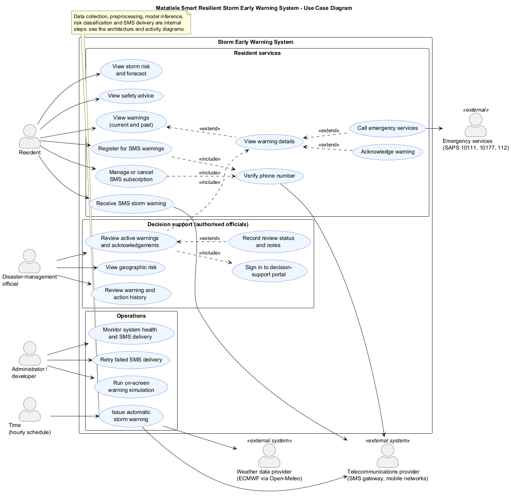
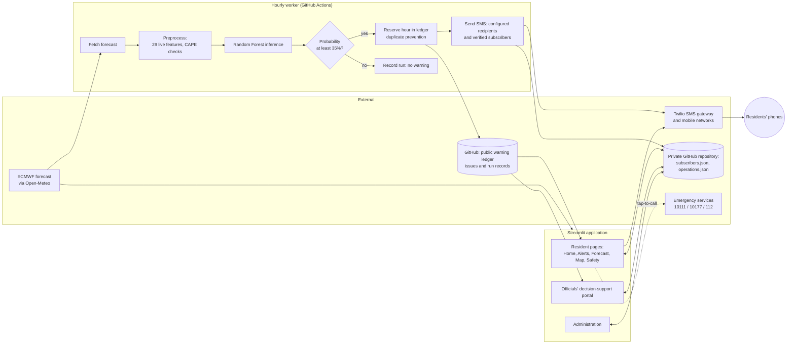
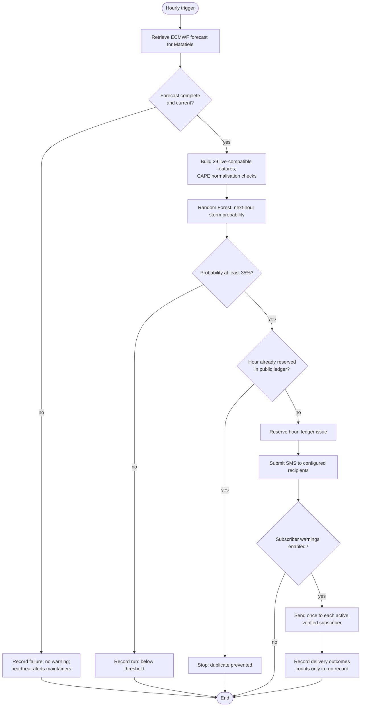
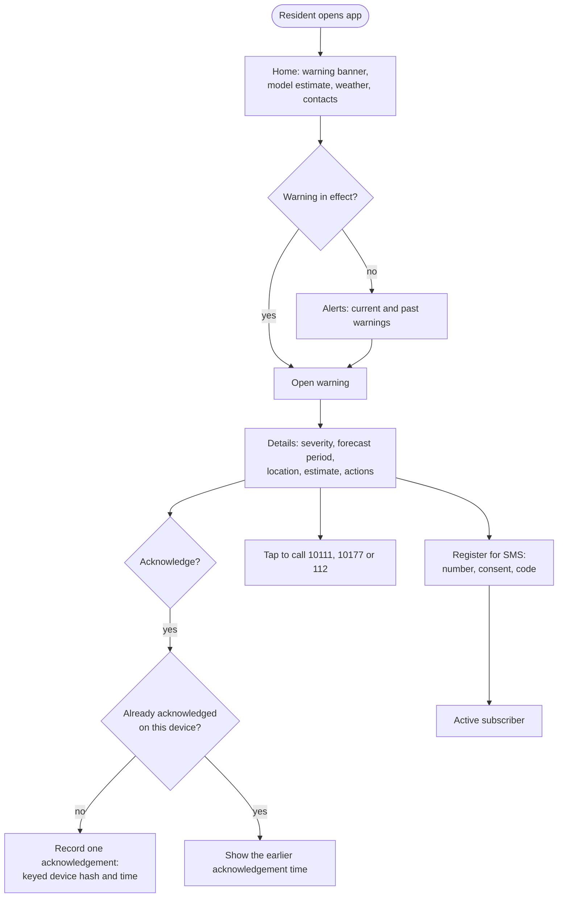
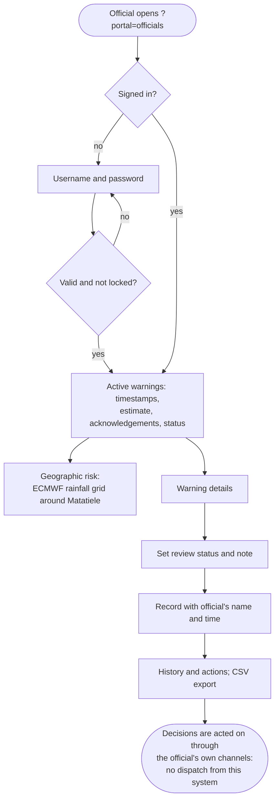
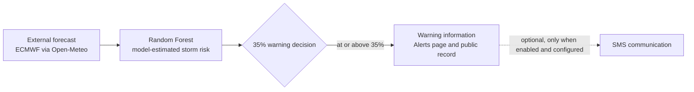

# System Design: Stakeholders, Use Cases, Architecture and Activities

This document is for research readers (supervisor, examiners) and maintainers. It describes the external actors, the interactive accounts that exist, and how the system works internally.

## 1. Stakeholders and roles

| Stakeholder | Role in the system | Interactive account? |
|---|---|---|
| **Residents of Matatiele** | View the next-hour storm estimate, the forecast, the map and safety advice. View current and past warnings and open their details. Acknowledge that a warning was viewed. Call emergency numbers. Register for, manage and cancel SMS warnings. | **No account.** Pages are public. SMS registration is verified by a one-time code. Acknowledgements are anonymous: one per device. |
| **Disaster-management officials** | In the decision-support portal (`?portal=officials`): <ul><li>review active warnings, their timestamps and aggregate acknowledgements;</li><li>view the forecast geography;</li><li>record a review or response status with notes;</li><li>review the history of warnings and actions.</li></ul> | **Yes.** Individual named accounts (`OFFICIAL_ACCOUNTS`, PBKDF2-hashed), so every review is attributed and timestamped. |
| **Emergency response services** (SAPS 10111, ambulance and fire 10177, 112) | Receive phone calls that residents start from the tap-to-call buttons. The system never contacts or dispatches them. | **No.** They have no workflow inside the system. |
| **Developers and administrators** | Monitor system health, subscriptions and SMS delivery (masked numbers); retry definitive delivery failures; run the on-screen warning simulation; maintain configuration and secrets. | **Yes.** Administrator password (`ADMIN_PASSWORD`). This is separate from official accounts. |
| **Telecommunications providers** (Twilio SMS gateway, mobile networks) | Deliver verification codes and warning SMS, and report delivery status and STOP opt-outs. | **No.** System-to-system integration. |
| **Weather data provider** (ECMWF via Open-Meteo) | Supplies the hourly forecast used as model input and for the map. | **No.** System-to-system integration. |

Accounts exist only for stakeholders whose workflows are implemented: officials and administrators.

## 2. Use case diagram

Source: [diagrams/use_case.puml](diagrams/use_case.puml) (PlantUML).

What the diagram includes, and what it deliberately leaves out:
- It shows **external actors and their goals only**.
- "View warning details" is **one use case** shared by residents and officials (the officials' review *includes* it), so there is no duplicated alert-review use case.
- Forecast retrieval, preprocessing, model inference, risk classification, duplicate prevention and SMS submission are **not** user use cases. They appear as the single time-triggered use case *Issue automatic storm warning*, detailed in §3 and §4.
- MQTT, LoRa and edge processing are future research and are not part of this system.

## 3. Architecture

| Store | Contents | Who writes |
|---|---|---|
| Public warning ledger (GitHub issues) | One issue per warning hour; no personal data | Worker |
| `subscribers.json` (private) | Encrypted numbers, keyed hashes, consent, delivery outcomes, warning copies with probability | Dashboard (residents) and worker |
| `operations.json` (private) | Acknowledgements (keyed device hashes per warning); officials' review statuses and notes (name and time) | Dashboard (residents and officials) |

## 4. Activity diagrams

### 4.1 Hourly storm assessment and warning (automatic)

### 4.2 Resident interaction with a warning

### 4.3 Official review of a warning

### 4.4 Workflow shown on the About page

The About page shows the main **resident-facing** warning workflow as one line. The officials' portal is a separate interface (see 4.3) and is not a stage in this workflow. SMS is optional, and its badge shows the real state: *not enabled*, *development outbox* or *configured*. Expandable sections explain how the model and system work (nine steps, verified against the project scripts) and the low-connectivity design.

